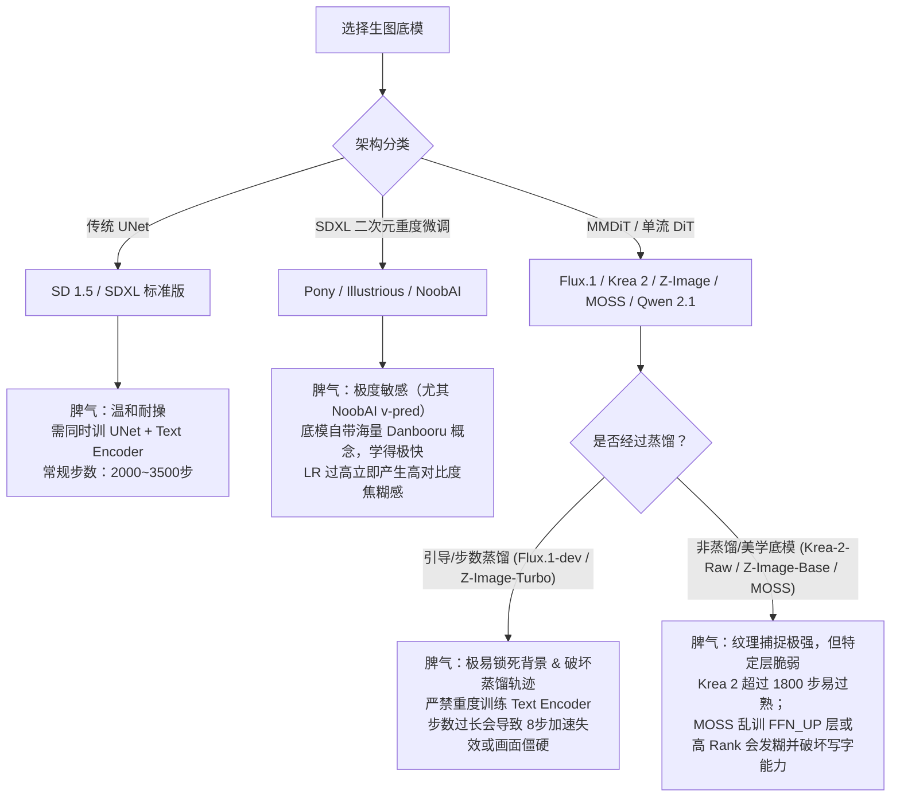

# 🎨 多模型生图 LoRA 训练参数、步数与打标全栈指南

> [!IMPORTANT]
> **核心认知：不同架构的底模，“脾气（拟合速度与崩溃边界）”截然不同。**
> 传统 UNet 架构（SD 1.5 / SDXL）与新一代 DiT / Flow-Matching 架构（Flux.1 / Krea / Z-Image / MOSS-Image / Qwen-Image），以及经过步数蒸馏（Turbo）或速度预测（v-pred）的模型，在**步数（Steps）、学习率（LR）、文本编码器（Text Encoder）处理、打标语法（Tag vs 自然语言）**上不能盲目套用同一套参数。

---

## 目录

1. [通用核心公式与底层黄金法则](#1-通用核心公式与底层黄金法则)
2. [全模型“拟合脾气”与崩溃特征全景对比](#2-全模型拟合脾气与崩溃特征全景对比)
3. [十大主流底模核心参数速查总表](#3-十大主流底模核心参数速查总表)
4. [分模型深度调参指南与避坑要点](#4-分模型深度调参指南与避坑要点)
   - [4.1 SD 1.5（经典 UNet 架构）](#41-sd-15经典-unet-架构)
   - [4.2 SDXL 标准版 vs Pony vs Illustrious / NoobAI (含 v-pred)](#42-sdxl-标准版-vs-pony-vs-illustrious--noobai-含-v-pred)
   - [4.3 Flux.1-dev（12B MMDiT 引导蒸馏架构）](#43-flux1-dev12b-mmdit-引导蒸馏架构)
   - [4.4 Krea 2 / Flux.1-Krea-dev（高质感美学微调底模）](#44-krea-2--flux1-krea-dev高质感美学微调底模)
   - [4.5 Z-Image（阿里通义造相：Z-Image-Turbo vs Z-Image-Base）](#45-z-image阿里通义造相z-image-turbo-vs-z-image-base)
   - [4.6 MOSS-Image（复旦 5B 单流 DiT + Qwen3.5-9B 架构）](#46-moss-image复旦-5b-单流-dit--qwen35-9b-架构)
   - [4.7 Qwen-Image 2.1 与 Fibo 2.0 dev（魔搭主力新模型补充）](#47-qwen-image-21-与-fibo-20-dev魔搭主力新模型补充)
5. [训练目标场景配方与 AI 画师图集特调](#5-训练目标场景配方与-ai-画师图集特调)
   - [5.1 训练目标场景配方（人物角色 / 画风风格 / 服装概念）](#51-训练目标场景配方人物角色--画风风格--服装概念)
   - [5.2 使用 AI 画师作品 / AI 生成图训练 LoRA 的专属调参指南](#52-使用-ai-画师作品--ai-生成图训练-lora-的专属调参指南)
6. [打标（Captioning）核心法则：何时写 Tag，何时写自然语言？](#6-打标captioning核心法则何时写-tag何时写自然语言)
7. [魔搭社区（ModelScope）免费在线 LoRA 训练器实操映射](#7-魔搭社区modelscope免费在线-lora-训练器实操映射)
8. [过拟合与欠拟合诊断排错表（Troubleshooting）](#8-过拟合与欠拟合诊断排错表troubleshooting)
9. [AI 辅助调参指令模板（当把本文档喂给 AI 时使用）](#9-ai-辅助调参指令模板当把本文档喂给-ai-时使用)
10. [Agent 自动化执行魔搭社区 LoRA 训练标准 SOP（供浏览器控制 Agent 直接复用）](#10-agent-自动化执行魔搭社区-lora-训练标准-sop供浏览器控制-agent-直接复用)

---

## 1. 通用核心公式与底层黄金法则

无论使用本地训练器（Kohya_ss / 秋叶训练器、`ai-toolkit`、`OneTrainer`、`DiffSynth-Studio`）还是云端平台（**魔搭社区 ModelScope 在线训练**），所有图像 LoRA 的步数都遵循以下唯一核心公式：

$$\text{总步数 (Total Steps)} = \frac{\text{图片张数 (Images)} \times \text{单图重复次数 (Repeats)} \times \text{训练轮数 (Epochs)}}{\text{批次大小 (Batch Size)} \times \text{梯度累积 (Gradient Accumulation)}}$$

### 关键概念拆解

| 参数名称 | 英文 / 配置项名 | 物理含义 | 调参黄金法则 |
| :--- | :--- | :--- | :--- |
| **单图重复次数** | `Repeats` (如文件夹 `10_role`) | 每一轮（1 Epoch）中，单张图片被模型重复观看的次数 | 主要用于平衡多文件夹权重或凑够单轮步数。在 `ai-toolkit` 或魔搭简化界面中常默认设为 `1`，直接通过增大 `Epochs` 或指定 `Max Steps` 控制总步数。 |
| **训练轮数** | `Epochs` | 整个数据集（含 Repeats）被完整遍历的次数 | 决定模型对整体数据集的复习次数。建议开启 **每隔 N 轮/步保存权重**，最佳模型往往出现在总进度的 **65% ~ 80%** 处。 |
| **等效批次大小** | $\text{Effective Batch Size} = \text{BS} \times \text{Grad Acc}$ | 每次更新权重时综合考虑多少张图片的梯度 | **Batch Size = 1** 更新最激进、捕捉微细节快但梯度噪点大（适合小数据集人物）；**Batch Size = 2 ~ 4** 梯度更平滑（适合画风/大数据集）。注意：Batch Size 翻倍时，总步数会减半！ |
| **学习率** | `Learning Rate (LR)` | 每次梯度更新迈出的步子大小 | **宁可步数稍多+学习率温和，切忌高学习率猛冲**。高 LR 造成的“权重烧毁（Deep-Fry / 色彩噪点崩坏）”是不可逆的。 |
| **网络维度 (秩)** | `Network Rank (Dim)` | LoRA 矩阵的容量大小（决定参数量与文件体积） | 常见值 `16`、`32`、`64`。**Rank 越大，记忆细节能力越强，但也越容易把训练集背景和瑕疵死记硬背（过拟合）**。 |
| **缩放系数** | `Network Alpha` | 对 LoRA 权重的缩放分子（实际缩放比为 $\frac{\text{Alpha}}{\text{Rank}}$） | 设为 `Alpha = Rank`（缩放比 $1.0$）时更新最直接；设为 `Alpha = 0.5 × Rank`（缩放比 $0.5$）时相当于给梯度加了缓冲垫，适合容易过拟合的大模型（如 Flux / Z-Image）。 |

---

## 2. 全模型“拟合脾气”与崩溃特征全景对比

在开始设置步数前，必须先了解目标底模的**收敛速度**与**过拟合/欠拟合倾向**：



### 各模型过拟合 vs 欠拟合倾向深度解析

1. **最容易“焦糊（Fried / 高对比度崩坏）”的模型**：**NoobAI-XL (v-pred)** 与 **Flux.1-Krea-dev (Krea 2)**
   - **NoobAI v-pred**：采用速度预测（Velocity Prediction）损失函数，动态范围极大。如果沿用普通 SDXL 的 `1e-4` 学习率或误开 `noise_offset`，往往不到 1000 步就会出现暗部死黑、边缘锐化过度、高饱和荧光噪点。
   - **Krea 2 (Flux.1-Krea)**：底模本身已经针对皮肤肌理、胶片颗粒、高频细节做了强化微调。训练时它会以极快的速度吸附训练集中的光影和微纹理，小图集超过 `1500 ~ 1800` 步极易“过熟（Overcooked）”，表现为人脸僵硬、皮肤质感像干裂油画。
2. **最容易“锁死背景与构图（Background Bleed）”的模型**：**Flux.1-dev** 与 **Z-Image-Turbo**
   - 这两者都属于**蒸馏模型**（Flux.1-dev 为引导蒸馏 Guidance-Distilled，Z-Image-Turbo 为 8 步时间步蒸馏）。
   - 它们的特征提取器极其敏锐，只要训练集里有 5 张以上相似背景或相似半身构图，且打标未把背景剥离干净，模型就会在 `1500` 步后将背景与触发词强行焊死，导致推理时换背景提示词完全失效。
3. **最容易“欠拟合（学不像 / 触发弱）”的场景**：
   - 在 **SD 1.5 / 原版 SDXL** 上训练复杂二次元角色却不训练 Text Encoder；
   - 在 **Flux.1 / Z-Image / MOSS-Image / Qwen-Image** 上使用简陋的单词 Tag（如仅写 `1girl, solo`）而非自然语言长句，导致强大的 T5 / Qwen 文本编码器无法对齐特征；
   - 数据集包含过多模糊、低分辨率、角度互相矛盾（如 Q 版与写实混放）的图片。

---

## 3. 十大主流底模核心参数速查总表

> [!TIP]
> 下表以 **标准 20 ~ 30 张高质量人物/角色数据集，Batch Size = 1（或等效 BS = 1~2），优化器使用 `AdamW8bit`** 为基准。如果是 **50 ~ 150+ 张的大规模画风（Style）训练**，步数与学习率请同步参考 [第 5.1 节画风阶梯表](#51-训练目标场景配方人物角色--画风风格--服装概念)。

| 基底模型 (Base Model) | 原生分辨率 | 推荐总步数 (20~30图) | 主干网络 LR (UNet / DiT) | 文本编码器 LR (Text Encoder) | 推荐 Rank / Alpha | 推荐打标方式 | 拟合特性与核心禁忌 |
| :--- | :--- | :--- | :--- | :--- | :--- | :--- | :--- |
| **SD 1.5** | `512×512`<br/>(或 `512×768`) | **2000 ~ 3500 步** | `1e-4` | `1e-5` ~ `5e-5` | `32 / 16`<br/>或 `32 / 32` | **Danbooru Tag**<br/>(WD14 打标器) | 底模容量小，需同时训 TE 才能记牢新概念；步数低于 1500 易欠拟合。 |
| **SDXL 1.0 (标准版)** | `1024×1024` | **1800 ~ 3000 步** | `1e-4` | `1e-5` ~ `2e-5`<br/>(或冻结) | `32 / 16` | **Tag + 简短自然语言** | 双 CLIP 结构，TE 学习率过高极易破坏构图与泛化性。 |
| **Pony Diffusion V6** | `1024×1024` | **1500 ~ 2500 步** | `5e-5` ~ `1e-4` | `1e-5` ~ `3e-5` | `32 / 16` | **质量前缀 + Tag**<br/>(`score_9...`) | 过拟合时极易出现“Pony 塑料油光脸”和固定怪异手势。 |
| **Illustrious / NoobAI ($\epsilon$-pred)** | `1024×1024` | **1500 ~ 2400 步** | `5e-5` ~ `8e-5` | `1e-5` ~ `2e-5` | `16 / 8` 或 `32 / 16` | **精准 Danbooru Tag**<br/>(WD-SwinV2-v3) | 原生认识数万动漫 Tag，**已认识的特征严禁保留在打标中**，否则学不进LoRA。 |
| **NoobAI-XL (v-pred)** | `1024×1024` | **1200 ~ 2000 步** | **`2e-5` ~ `5e-5`**<br/>*(必须压低!)* | **`5e-6` ~ `1e-5`**<br/>*(或冻结)* | `16 / 8` 或 `32 / 16` | **精准 Danbooru Tag** | **极易焦糊过曝！** 必开 `v_parameterization` 与 `zero_terminal_snr`，强制 `noise_offset = 0`，LR 禁上 `1e-4`。 |
| **Flux.1-dev** | `1024×1024`<br/>(支持多比例分桶) | **1500 ~ 2500 步** | `1e-4` | **`0` (冻结不训)** | `16 / 16` 或 `32 / 16` | **自然语言长句**<br/>(JoyCaption / Qwen-VL) | 训 TE 会直接毁掉 T5 语义；本地必设 `guidance_scale = 1.0`；超 3000 步易把背景焊死。 |
| **Krea 2 / Flux.1-Krea-dev** | `1024×1024` | **1000 ~ 1800 步**<br/>*(甜点区偏早)* | `5e-5` ~ `1e-4` | **`0` (冻结不训)** | `16 / 16` 或 `32 / 32` | **自然语言 + 0.05~0.1 Dropout** | **微纹理吸收极快**，禁用 Prodigy 自适应优化器，小图集超 2000 步易出现皮肤焦糊。 |
| **Z-Image-Turbo / Base** | `1024×1024` | **1500 ~ 2500 步** (Turbo)<br/>**2000 ~ 3000 步** (Base) | `1e-4` (Turbo)<br/>`5e-5 ~ 1e-4` (Base) | **`0` (冻结 Qwen TE)** | `16 / 16` 或 `32 / 16` | **中/英自然语言描述** | Turbo 版直接裸训会破坏 8 步加速轨迹（需挂 De-distill Adapter 或用魔搭官方管线）。 |
| **MOSS-Image (Base / SFT)** | `1024×1024`<br/>*(长宽必为 16 倍数)* | **800 ~ 1500 步**<br/>*(20~30图甜点偏短)* | `5e-5` ~ `1e-4` | **`0` (冻结 Qwen3.5-9B)** | **`8 / 8` 或 `16 / 16`**<br/>*(严禁高 Rank)* | **自然语言 / JSON Layout** | 本地首选 `Base`，魔搭云端用 `SFT`；高 Rank (>16) 易发糊；乱训 `FFN_UP` 毁写字能力；推理必设 50步+Shift=5.0。 |
| **Qwen-Image 2.1** | `1024×1024`<br/>(支持多比例) | **1500 ~ 2500 步** | `5e-5` ~ `1e-4` | **`0` (冻结 Qwen-VL TE)** | `16 / 16` 或 `32 / 16` | **中/英自然语言详述** | 魔搭默认首推底模；**训纯画风可不设触发词**，训角色建议设独特拼音触发词。 |

---

## 4. 分模型深度调参指南与避坑要点

### 4.1 SD 1.5（经典 UNet 架构）

- **适用场景**：老牌二次元/写实生态、低显存设备（6G~8G 即可本地跑）、配合海量 ControlNet 插件。
- **步数与 Repeat 设计**：
  - 经典经验法则：**单张图片总被观看次数（$\text{Repeats} \times \text{Epochs}$）控制在 `100 ~ 150` 次左右**。
  - 例如：20 张图，设置 `Repeats = 10`，`Epochs = 10 ~ 15`，`Batch Size = 1`，总步数即为 $20 \times 10 \times (10\sim 15) = 2000 \sim 3000$ 步。
- **学习率调度器（LR Scheduler）**：推荐 `cosine_with_restarts`（余弦退火重启，Cycles 设为 2~3）或 `cosine`，Warmup 设为总步数的 `5%`。
- **防过拟合要点**：SD 1.5 原生分辨率仅 `512×512`（或 `512×768`），如果强行喂 `1024×1024` 训练，不仅慢还会出现“双头/多肢体”崩坏。

---

### 4.2 SDXL 标准版 vs Pony vs Illustrious / NoobAI (含 v-pred)

这四个同属 SDXL 家族，但内部权重分布与损失函数差异巨大，**绝对不能混用同一套学习率**。

#### (1) Pony Diffusion V6 XL
- **打标特殊要求**：训练时关于是否保留 `score_9, score_8_up, score_7_up` 存在两派做法，目前社区最佳实践是**训练集中不写 score 词（或仅对低画质图写低分词）**，让概念绑定在纯触发词上，推理生图时再在正向提示词开头加上 `score_9, score_8_up, score_7_up`。
- **过拟合信号**：当生成的人物脸上出现不自然的油腻高光、手指动作固定成某种扭曲姿势时，说明步数已超标，立刻回退 2~3 个 Epoch。

#### (2) Illustrious XL 与 NoobAI-XL ($\epsilon$-pred 常规噪声预测版)
- **核心特性**：这两个模型内置了极其庞大的 Danbooru 标签知识。
- **步数与学习率**：收敛速度比原版 SDXL 快约 **30%**。20 张图在 `Batch Size = 2` 下，往往 **1200 ~ 1800 步**（或 `BS = 1` 下 `1800 ~ 2400` 步）就已经完全学会。
- **打标铁律（极重要）**：因为底模对 `twintails`（双马尾）、`ahoge`（呆毛）、`red eyes`（红瞳）等标签极其敏感，如果你训练一个固定角色，**必须把代表该角色核心外貌的 Tag 从 `.txt` 打标文件中彻底删掉**（只留触发词 `role_trigger` + 衣服/动作/背景 Tag），否则特征会被底模原有 Tag 吸走，不写 Tag 就召回不出角色特征！

#### (3) NoobAI-XL (v-pred 速度预测版) —— ⚠️ 高危易炸模型
- **底层差异**：采用 `v-prediction` 参数化与零终端信噪比（Zero Terminal SNR），使得模型能画出纯黑、纯白与极高动态范围的光影。
- **专属必开配置（本地 Kohya_ss / sd-scripts）**：
  ```toml
  v_parameterization = true
  zero_terminal_snr = true
  # 警告：开启 zero_terminal_snr 时，必须强制关闭 noise_offset（设为 0），否则必出现严重全局偏色与色阶断裂！
  noise_offset = 0
  # 以下损失缩放项建议二选一，切勿把 scale_v_pred_loss 与 min_snr_gamma 叠加同开：
  debiased_estimation_loss = true # 推荐：无偏估计损失，替代 min_snr_gamma
  ```
- **学习率强制限流**：
  - **UNet LR**：必须压低至 **`2e-5` ~ `5e-5`**（例如 `3e-5`）。严禁使用 `1e-4`！
  - **Text Encoder LR**：压低至 **`5e-6` ~ `1e-5`**，或者干脆只在前半程训练 TE。
  - **总步数**：比 $\epsilon$-pred 版本再少 15%~20%，`1200 ~ 2000` 步内必出甜点权重。

---

### 4.3 Flux.1-dev（12B MMDiT 引导蒸馏架构）

- **为什么 Flux 不能按 SDXL 的习惯训？**
  1. **参数量达 120 亿（12B）**，采用 Flow Matching（流匹配）替代传统扩散 DDPM，且经过了 Guidance Distillation（引导蒸馏）。
  2. **双文本编码器（T5-XXL + CLIP-L）**：T5-XXL 拥有强大的自然语言理解能力，如果在 LoRA 训练中强行给 Text Encoder 挂高学习率，会在几百步内导致模型丧失语言理解能力，画面变成色块噪点。
- **核心推荐配置**：
  - **只训 Transformer（DiT 主干），冻结 Text Encoder（`train_text_encoder = False`）**。
  - **训练引导系数（Guidance Scale）**：本地训练（`ai-toolkit` / `sd-scripts`）时务必设置 **`guidance_scale = 1.0`**（切勿设为推理时的 `3.5`），避免训练梯度与引导蒸馏分布剧烈对抗产生网格伪影。
  - **Rank / Alpha**：人物推荐 `Rank = 16, Alpha = 16` 或 `Rank = 32, Alpha = 16`；复杂画风推荐 `Rank = 32 ~ 64, Alpha = 16 ~ 32`。
  - **时间步采样（Timestep Sampling）**：推荐使用 `sigmoid` 或 `shift`（`discrete_flow_shift = 3.0` 左右），让模型重点学习中等噪声阶段的构图与五官，而非死磕纯噪点或极微小的像素噪点。
  - **步数区间**：
    - 15~25 张人物图（`BS = 1`）：**1500 ~ 2500 步**（每隔 250 步保存一次，通常 **1500 步** 泛化最好，**2000 步** 最像，**2500 步** 以上开始锁背景）。

---

### 4.4 Krea 2 / Flux.1-Krea-dev（高质感美学微调底模）

- **模型特性与版本区分**：广义 Krea 管线包含本地开源的 **`Flux.1-Krea-dev`**（基于 Flux 架构针对商业摄影、微距皮肤肌理、胶片美学深度强化的 12B 底模）以及魔搭云端首推的 **`Krea 2`** 预设管线（魔搭前端按钮标识为 `template_FLUX_1_KREA`，底层采用 **未蒸馏原版 `krea/Krea-2-Raw` 训练 + 极速版 `krea/Krea-2-Turbo` 推理** 的双轨机制）。
- **与原版 Flux.1-dev 的训练差异（为什么极易过拟合？）**：
  - 原版 Flux.1-dev 有明显的“塑料感/平滑下巴（Flux Chin）”，需要较多步数才能压制底模的塑料皮肤；
  - 而 **Krea 底模本身已经自带极强的高频纹理和写实光影**！如果还是按原版 Flux 跑 2500~3000 步，高频特征会被双重放大，导致画面迅速“焦糊（Overcooked）”、对比度炸裂、背景死锁。
- **Krea 专属调参守则**：
  1. **步数砍掉 25% ~ 35%**：15~30 张图的标准人物/产品集，**1000 ~ 1800 步**即达巅峰！务必从 **第 750 步** 开始每 250 步保存并抽卡测试（50~80 张画风集则为 `2000 ~ 2600` 步）。
  2. **拒绝自适应优化器（禁用 Prodigy）**：在 Krea 底模上，`Prodigy` 往往会在前 500 步把内部实际学习率推得过高，直接烧毁底模细腻的光影。老老实实使用 **`AdamW8bit`**，固定学习率 **`1e-4`（人物）** 或 **`5e-5` ~ `8e-5`（画风/微调）**。
  3. **必开 Caption Dropout（标签随机丢弃）**：设置 `caption_dropout_rate = 0.05 ~ 0.1`，防止 Krea 把单张图里的环境光和相机景深死死绑定到触发词上。

---

### 4.5 Z-Image（阿里通义造相：Z-Image-Turbo vs Z-Image-Base）

阿里云开源的 **Z-Image（6B 单流 S3-DiT 架构，搭载 Qwen 系列文本编码器）** 是目前魔搭社区（ModelScope）及开源界最火的极速中文/英文双语生图模型之一。训练前必须分清你选的是 **Turbo 版** 还是 **Base 版**！

| 对比项 | `Tongyi-MAI/Z-Image-Turbo` (8步极速版) | `Tongyi-MAI/Z-Image-Base` (非蒸馏完整版) |
| :--- | :--- | :--- |
| **底层机制** | 经过 8 步时间步蒸馏 + 无分类器引导蒸馏（CFG=1.0 即可出图） | 完整保留原始 Flow Matching 轨迹，推理需 25~35 步 |
| **直接裸训的后果** | **极高风险！** 若不挂训练适配器直接按常规方式训，训练超过 1500 步就会**破坏 8 步蒸馏结构**，导致推理时 8 步全是模糊噪点，必须拉到 30 步才能看！ | 训练轨迹平稳，适合深度定制复杂画风、多概念融合 |
| **正确训练姿势** | 1. 在魔搭在线训练器中选择官方适配好的 Z-Image 管线；<br/>2. 本地使用 `ai-toolkit` 时，**必须挂载 `Z-Image-Turbo-Training-Adapter`（去蒸馏训练适配器）**。 | 直接使用标准 S3-DiT 训练脚本微调即可。 |
| **推荐学习率** | `1e-4` (`AdamW8bit`) | `5e-5` ~ `1e-4` (`AdamW8bit`，Base 版对大梯度更敏感，建议温和更新) |
| **推荐总步数 (20~30图)** | **1500 ~ 2500 步**（甜点常在 1750~2250 步，严禁超 3500 步） | **2000 ~ 3000 步** |
| **打标语言偏好** | 原生支持**中文与英文自然语言长句**！使用 Qwen-VL 反推的详细中文或英文客观描述效果最佳。 | 同左，中英自然语言皆可。 |

---

### 4.6 MOSS-Image（复旦 5B 单流 DiT + Qwen3.5-9B 架构）

复旦大学 OpenMOSS 团队开源的 **MOSS-Image** 采用 **5B 单流 DiT（SiTU-GLU FFN 结构）** 配合庞大的 **`Qwen3.5-9B` 文本编码器**（文本编码器比图像主干还大！），在中日英复杂汉字渲染、海报排版、精准空间布局上实力极强。也正因这套独特架构，它训练 LoRA 时与 SDXL、Flux 有 **6 个截然不同的参数要求**：

1. **Rank 与 Alpha 必须偏小（`8/8` 或 `16/16`），切忌照搬 SDXL 的高 Rank**：
   - 在 SDXL 或 Flux 中常有人开 `Rank 32 ~ 64`，但在 MOSS-Image 上，社区大量实测（`KohakuMossTrainer` / `Fizgig` / `ai-toolkit`）表明：**Rank 超过 16~32 反而会导致画面细节发糊、浑浊（Muddy Details）**！
   - **最佳值**：无论人物还是画风，均强烈推荐锁死 **`Rank = 8, Alpha = 8`** 或 **`Rank = 16, Alpha = 16`**（注意：魔搭云端默认 `networkDim = 32`，训 MOSS 时建议点开专业参数手动调小为 **`16`**），不仅微细节最锐利，且本地配合 NF4/INT8 量化在 **6GB ~ 12GB 显存** 上就能跑通。
2. **常规图集（20~30张）总步数比 Flux / SDXL 短得多（甜点区仅 `800 ~ 1500 步`）**：
   - 20 ~ 30 张图的人物或小规模风格集，通常在 **800 步** 左右相似度就已成型，**1000 ~ 1500 步** 达到巅峰。如果小图集按老习惯拉到 3000 步以上，会导致严重的对比度丢失和泛化坍缩。（*注：若为 `50 ~ 150+` 张的大规模画风训练集，则需在将学习率压低至 `3e-5 ~ 8e-5` 的前提下，按 5.1 节阶梯表放宽至 `2000 ~ 3800` 步。*）
3. **时间步采样缺陷与“五官学不像”的解法（Clean-End Noise Schedule）**：
   - **痛点**：MOSS-Image 默认的原生时间步分布（Timestep Schedule）在“低噪声尾段（Near-clean end，即决定五官精细度与皮肤纹理的最后阶段）”分配的步数占比极少。如果用默认均匀采样训，会出现“衣服构图学会了，但脸怎么都学不像”。
   - **参数对策**：
     - 在本地训练器中开启针对低噪尾段的偏移调度（如 `Fizgig v8.8.1+` 专为 MOSS 设计的 **`Slide (Clean-end share)`** 模式，或在 `ai-toolkit` 中配置对应的 `timestep_shift`）；
     - **严禁开启 `min_snr_gamma`（SNR 权重）**，Flow Matching 模型开传统 SNR 加权会直接破坏流匹配轨迹；
     - **关闭 EMA（指数移动平均）**，EMA 会让 MOSS 的高频细节变钝发肉。
4. **`FFN_UP` 层与长文本写字能力的取舍（Layer Targeting）**：
   - MOSS 每个块内含 `ffn_up`、`ffn_gate`、`ffn_down` 层。如果无差别对 **`FFN_UP`** 层挂高秩猛训，会**迅速破坏模型原生的中日英汉字书写与排版能力**（训完后写不出正确文字了）；但若完全排除 `FFN_UP` 只训 `VO` 和 `FFN_DOWN`，画风还原度又会变弱。
   - **最佳平衡点**：保持全层训练但严格限制 **`Rank = 8 ~ 16` + 温和学习率 `5e-5 ~ 1e-4`**；或在支持分层设置的本地训练器（如 `KohakuMossTrainer`）中单独将 `FFN_UP` 的 Rank/LR 减半。
5. **硬性前置条件（本地 Base vs 云端 SFT 底模、9B 编码器冻结与 16 倍数分辨率）**：
   - **底模选择区分本地与云端**：本地训练器优先选 **`OpenMOSS/MOSS-Image-Base`**（未经过强后训练，底层特征最宽）；而在**魔搭社区在线训练**时，直接选择官方预设的 **`MOSS Img SFT`（`openmoss/MOSS-Image-SFT`）** 即可（因 SFT 版已完成美学与指令对齐，在魔搭训练时更要严控 `Rank = 16` 与合理步数）；
   - **`Qwen3.5-9B` 文本编码器必须 100% 冻结（Frozen）并开启预缓存（Text Embedding Caching）**；
   - **训练分辨率长宽必须是 `16` 的正整数倍**（如 `1024×1024`、`768×1024`、`1024×1280`），否则 Patch 切分直接报错或错位。
6. **推理测试时的巨大反差（别把“推理步数不够”当成“LoRA 训坏了”）**：
   - 训完测试 LoRA 时，MOSS-Image **不能像 Z-Image 用 8 步，也不能像 Flux 用 20 步**！
   - **官方强制推理标准**：采样步数必须 **$\ge 50$ 步**，**`Shift = 5.0`**（极其关键！默认若为 1.0 或 3.0 画面必崩），**`CFG = 3.0 ~ 6.0`**（长提示词用 `3.0`，短提示词用 `5.0~6.0`），采样器选 **`Euler`**（或 `er_sde + beta`）。

---

### 4.7 Qwen-Image 2.1 与 Fibo 2.0 dev（魔搭主力新模型补充）

1. **`Qwen-Image 2.1` (`Qwen/Qwen-Image-2.1`)**：
   - **定位**：阿里通义千问原生多模态生图底模，也是魔搭在线训练台排在第一位的默认首推预设。
   - **触发词特殊机制**：官方明确指出，使用 Qwen-Image 2.1 **训练纯画风（Style）时可以留空不设触发词**（直接实现全局审美与笔触迁移）；训练特定角色/IP 时再设置独特拼音触发词。
   - **推荐参数**：20~30 张角色图推荐 `1500 ~ 2200` 步（LR `1e-4`），50~80 张画风图推荐 `2200 ~ 3200` 步（LR `5e-5 ~ 8e-5`），`Rank = 16 ~ 32`，采用 `Florence2 (详细模式)` 或 `JoyCaption` 生成详细自然语言打标。
2. **`Fibo 2.0 dev` (`briaai/Fibo-2.0-dev`)**：
   - **定位**：Bria AI 发布的 100% 版权合规商业级扩散底模，适合企业级电商产品、商业包装材质与特定品牌视觉微调。
   - **推荐参数**：训练脾气与 `Flux.1-dev` 接近，20~30 张图推荐 `1500 ~ 2500` 步，学习率 `1e-4`（画风 `5e-5 ~ 8e-5`），`Rank = 16 ~ 32`，使用英文自然语言详细打标。

---

## 5. 训练目标场景配方与 AI 画师图集特调

### 5.1 训练目标场景配方（人物角色 / 画风风格 / 服装概念）

同一个底模，训练**人物（Character）**、**画风（Style）**、**特定服装/物品（Concept/Outfit）**时，参数重心完全不同：

| 维度 | 👤 人物 / 角色 / IP LoRA | 🎨 画风 / 艺术风格 LoRA | 👗 特定服装 / 产品 / 局部概念 LoRA |
| :--- | :--- | :--- | :--- |
| **核心目标** | 锁死五官、发型、身材比例，同时允许灵活换装、换动作、换背景 | 提取笔触、色彩倾向、光影氛围，绝对不能锁死某一张具体人脸或构图 | 锁死服装款式/材质/产品造型，允许穿在不同人物身上或放在不同场景中 |
| **最佳数据集张数** | **15 ~ 30 张**（精不在多！3~5张大头特写 + 10~15张半身多角度 + 5张全身） | **50 ~ 150+ 张**（30张仅为起步门槛；**60~120张**能实现跨题材/跨构图的高泛化画风） | **15 ~ 25 张**（同一件衣服/产品穿在不同模特身上、不同角度与光线下） |
| **Network Rank / Alpha** | 中等：`16 / 16` 或 `32 / 16`<br/>*(MOSS 角色锁死 `8 / 8` 或 `16 / 16`)* | 偏大：`32 / 16` 或 `64 / 32`<br/>*(注：MOSS 底模例外，MOSS 画风仍锁死 `16 / 16`)* | 偏小至中等：`16 / 8` 或 `16 / 16`<br/>*(防止把模特的脸一起记进去)* |
| **Batch Size 策略** | **`1` ~ `2`**（小步快跑，精准刻画五官面部细节） | **`2` ~ `4`**（平滑单张图的具体内容，只提取共性画风梯度） | **`1` ~ `2`** |
| **学习率调整** | 基准值（如 `1e-4`） | **比人物低 20% ~ 50%**（如 `5e-5` ~ `8e-5`），慢火细炖防内容污染 | 基准值（如 `1e-4`） |
| **触发词策略** | **必须设置唯一稀有触发词**（如 `lixiaoyao_role`） | 可设风格触发词（如 `by_xxx_style`），Qwen/Flux 画风也可无触发词全局激活 | **必须设置概念触发词**（如 `cyber_jacket_v1`），搭配颜色/部件词 |
| **打标（去留原则）** | **删掉五官与固有发型词**，详细写出衣服、表情、动作、背景、镜头角度 | **详细写出画面里所有的主体内容**（人物外貌、物体、场景），不写画风词（或仅留触发词） | **删掉服装本身的细节词**（用触发词代替），**极其详细地写出模特的长相、发型、背景**（把模特长相剥离出去！） |

#### 📊 画风 LoRA 专属：不同图片数量（30张 ~ 200+张）的步数与学习率阶梯表

训练画风时，30 张图往往只能学会“半身美少女特写”的局部画风；想要画风在**全身动态、男性角色、纯风景建筑、暗夜/逆光**下都能稳定发挥，推荐扩充到 **60 ~ 120 张以上**（这也是为什么魔搭给 `MOSS Img SFT` 和 `Krea 2` 开放了 **300 张** 的免费上限）。随着张数增加，步数与学习率需按以下阶梯调整：

| 画风图集规模 | 适用效果层级 | MOSS / Krea 2 推荐总步数 | Flux / Z-Image / SDXL / Qwen 推荐总步数 | 推荐学习率 (LR) | 选图与调参核心要点 |
| :--- | :--- | :--- | :--- | :--- | :--- |
| **25 ~ 35 张** | 轻量尝鲜 / 单一题材画风 | **1400 ~ 1600 步** | **1800 ~ 2200 步** | `8e-5` ~ `1e-4` | 仅适合测试画风契合度，容易受限于训练集里的构图比例。 |
| **50 ~ 80 张**<br/>*(⭐ 黄金主力区间)* | **高泛化主力画风**（兼顾人物/景物/多光影） | **2000 ~ 2600 步**<br/>*(魔搭可直接选 `轻量 2000` 或填 `2200~2400`)* | **2500 ~ 3500 步** | **`5e-5` ~ `8e-5`** | **性价比最高！** 既有充足的多样性抵消具体角色长相，又不会混入画师早期劣质旧图。 |
| **90 ~ 150 张** | 大师级全频段画风复刻 | **2800 ~ 3800 步** | **3500 ~ 5000 步** | **`5e-5`** | 步数增加后必须把学习率压低至 `5e-5`，用“低学习率 + 多步数”慢火萃取出纯粹的笔触共性。 |
| **150 ~ 300 张** | 画师全画集深度蒸馏 | **4000 ~ 5500 步** | **5000 ~ 7000 步** | **`3e-5` ~ `5e-5`** | 此时魔搭默认的 `推荐 (6000步)` 才真正匹配！注意：长步数下务必防止画师早期与近期画风断层。 |

> [!WARNING]
> **画风扩充到 80+ 张时的最大陷阱：「画师早期 vs 近期画风断层」！**
> 许多人类画师（如 Pixiv 上的多年老画师）在 2019~2021 年的早期作品与 2024~2026 年的近期作品在**上色厚涂度、脸部比例、光影通透感**上差异极大。如果为了凑够 150 张把画师 5 年前平涂生涩的旧作也塞进训练集，练出来的 LoRA 会出现“质感打架（一会儿厚涂一会儿平涂）”。**宁可选 60~80 张画师最近两年画风高度统一的巅峰期作品（优先展开画师近期多图合集动态中的 `p0, p1, p2...` 独立插画或翻页采集近期独立作品，切忌拿同一张图重复裁切充数），也绝不要拿早年旧图硬凑数量！**

---

### 5.2 使用 AI 画师作品 / AI 生成图训练 LoRA 的专属调参指南

如果你选择 **AI 画师的优秀作品集**（如 Midjourney / Niji 精调图、大佬混融模型直出图或 AI 精修插画/摄影）作为训练集来炼制画风或角色 LoRA，完全不需要过滤 AI 图，但需要注意 **AI 图集在潜空间（Latent Space）中的拟合速度比传统手绘/实拍图快得多**，调参时遵循以下 4 条专属优化法则效果最佳：

1. **步数需比常规手绘/实拍图下调 `15% ~ 25%`（核心差异）**：
   - AI 画师的图本身就处于扩散模型的特征分布内，底模吸收起来几乎没有“跨模态阻力”。
   - 例如：常规 30 张手绘画风图在 Flux / Z-Image 上可能需要 `2200 ~ 2800` 步，但如果是 **30 张 AI 画师的图，往往在 `1500 ~ 2000` 步** 就已经完美复刻光影与厚涂质感！步数拉太高反而会导致对比度过饱和。
2. **学习率与 Rank 建议“温和收敛”**：
   - 训练 AI 画师风格时，推荐使用 **`AdamW8bit` + 学习率 `5e-5 ~ 8e-5`**（比常规 `1e-4` 略降一点），`Rank / Alpha` 设为 `32 / 16`。这样能极其细腻地吸取 AI 画师独特的调色、空气感与光影，而不会把高频噪点放大。
3. **挑图重“手眼干净度”与“构图多样性”**：
   - 收集 AI 画师作品时，优先挑这位画师**已经精修过手部、眼神光对称、细节清晰**的代表作；
   - 如果该 AI 画师的图全是同一种“大头贴正面照”（AI 圈常见现象），在打标时务必把每一张图的**发型、发色、瞳色、服装**写得极其详尽，防止炼出来的画风 LoRA 把所有生成人物都锁死成同一张网红脸！
4. **跨底模迁移的红利**：
   - 将 **Midjourney / Niji / NovelAI / SDXL 二次元大佬** 产出的高审美图集，用来训练 **Flux.1 / Z-Image / Krea 2** 的画风 LoRA，是目前极佳的“跨架构审美移植”玩法——既能保留 AI 画师顶级的光影构图审美，又能借助新底模强大的肢体和自然语言控制力！

---

## 6. 打标（Captioning）核心法则：何时写 Tag，何时写自然语言？

> [!WARNING]
> **打标第一性原理（反直觉但最关键）：**
> - **凡是你希望“通过触发词自动带出来”的特征** $\longrightarrow$ **在打标文本中必须删掉（不要写）！**
> - **凡是你希望“生图时可以自由更换/剥离”的特征**（如背景、路人、特定衣服、特定打光） $\longrightarrow$ **在打标文本中必须详细写出来！**

### 为什么这么做？
训练 LoRA 的本质是让模型做“减法填空题”。当训练图片里有一个“红发、蓝眼、穿白衬衫、站在教室里的女孩”：
- 如果打标写：`trigger_word, 1girl, white shirt, classroom, standing, smile`（**故意不写** `red hair, blue eyes`）；
- 模型在训练时就会恍然大悟：*“原来 `white shirt` 是白衬衫，`classroom` 是教室，那画面里多出来的‘红发蓝眼’特征一定就等于 `trigger_word`！”*
- 反之，如果你把 `red hair, blue eyes` 也写进了打标里，模型就会认为这些只是普通自带词，从而不会把特征存进 `trigger_word` 权重中！

---

### 两大打标流派对比与模板

#### 流派 A：Danbooru 词组标签流（适合：SD 1.5、Pony、Illustrious、NoobAI）
- **推荐自动打标工具**：`wd-swinv2-tagger-v3` 或 `wd-eva02-large-tagger-v3`（阈值 Threshold 建议设为 `0.35 ~ 0.4`）。
- **标准语序结构**：
  ```text
  [触发词], [人数/主体], [保留的可变服装/配饰], [动作/姿态/表情], [镜头视角], [背景/环境/光影]
  ```
- **人物 LoRA 打标实例（假设角色固有特征是：银色长发、紫瞳、猫耳）**：
  - ❌ **错误打标**（把固有特征全写了，导致触发词失效）：
    `my_neko_girl, 1girl, solo, silver hair, long hair, purple eyes, cat ears, school uniform, serafuku, sitting, classroom, sunlight, upper body`
  - ✅ **正确打标**（剔除固有外貌，保留服装与场景）：
    `my_neko_girl, 1girl, solo, school uniform, serafuku, navy neckerchief, sitting on desk, looking at viewer, gentle smile, upper body, classroom, window, sunlight, depth of field`

#### 流派 B：自然语言长句流（适合：Flux.1、Krea 2、Z-Image、MOSS-Image、Qwen-Image）
- **推荐自动打标工具**：`JoyCaption`、`Qwen2.5-VL / Qwen3-VL`、`Florence-2`。
- **为什么 DiT 模型必须用自然语言？**
  Flux（T5-XXL）和 Z-Image / MOSS-Image（Qwen 文本编码器）在预训练时阅读的是完整句子，能够理解主谓宾逻辑与空间方位（如 *“左手拿着咖啡杯，背景右侧有一盏暖光落地灯”*）。如果只喂碎词 Tag，文本编码器激活不充分，极易欠拟合或破坏画面连贯性。
- **人物 LoRA 自然语言打标模板（中/英对照）**：
  - **英文模板（Flux / Krea / Z-Image 通用）**：
    ```text
    A medium shot portrait of [触发词], a young woman wearing a vintage oversized leather jacket and a white t-shirt. She is tilting her head slightly with a soft smile, looking directly at the camera. She stands on a rainy neon-lit cyberpunk street at night, with blurred colorful reflections in the background and soft rim lighting on her shoulders.
    ```
    *(注意：句中只用 `a young woman` 指代，不细致描写她的五官与发色，让 `触发词` 吸收她的五官和固有发型；但把皮夹克、动作、雨夜霓虹背景写得一清二楚。)*
  - **中文模板（Z-Image / MOSS-Image / Qwen-Image 原生支持）**：
    ```text
    [触发词]，近景半身人像摄影，一位身穿浅蓝色针织开衫与白色内搭的年轻女性，微微侧头面向镜头露出温柔微笑。背景是午后洒满阳光的木质书房，身后有虚化的书架与绿植，柔和的自然侧逆光勾勒出人物轮廓，景深自然。
    ```

---

## 7. 魔搭社区（ModelScope）免费在线 LoRA 训练器实操映射

通过实际打开并操作魔搭社区 AIGC 专区 **[模型训练页面](https://www.modelscope.cn/aigc/model-training)**，以下是当前线上真实界面的**完整操作动线、隐藏机制与关键避坑指南**：

### 7.1 顶部「模型选择」快捷栏真实映射与隐藏机制

进入页面后，左上角「模型选择 $\rightarrow$ 图像模型」默认提供 **6 个快捷入口**，点击不同卡片会自动切换底层 Checkpoint 与图片上限：

| 魔搭界面卡片名称 | 实际挂载的官方底模 ID | 底层架构标识 (`sdVersion`) | 图片数量上限 | 平台隐藏机制与实操注意点 |
| :--- | :--- | :--- | :--- | :--- |
| **`Qwen Img 2.1`** | `Qwen/Qwen-Image-2.1` | `QWEN_IMAGE_2_1` | `10 ~ 100 张` | 官方提示：**训练 Qwen Image 可以不设置触发词**（画风类尤佳，角色类仍建议设拼音触发词）。 |
| **`Krea 2`** | `krea/Krea-2-Turbo` | `KREA_2` (`KREA_2_TURBO`) | **`10 ~ 300 张`** | ⚠️ **官方底层机制**：系统提示*“为保证模型效果，LoRA 将会基于 **`Krea-2-Raw`**（未蒸馏原版）训练，训练完成后基于 **`Krea-2-Turbo`** 推理”*，因此无需担心破坏 Turbo 蒸馏！ |
| **`MOSS Img SFT`** | `openmoss/MOSS-Image-SFT` | `MOSS_IMAGE_SFT` | **`10 ~ 300 张`** | 魔搭默认挂载的是 `SFT` 版本。注意步数千万不要用默认的 6000 步，手动改成 **`1000 ~ 2000` 步**！ |
| **`Z Image`** | `Tongyi-MAI/Z-Image` | `Z_IMAGE_TURBO` | `10 ~ 100 张` | 底层按 `Z_IMAGE_TURBO` 管线处理，官方已内置加速兼容，步数建议设在 **`1500 ~ 2500` 步**。 |
| **`Fibo 2.0 dev`** | `briaai/Fibo-2.0-dev` | `FIBO_2_0_DEV` | `10 ~ 100 张` | Bria 开源商业合规底模，适合商业素材与特定风格微调。 |
| **`更多模型`** | 点击下方 `选择模型` 按钮自由搜索 | `CUSTOM` (支持 SD1.5 / SDXL / Flux.1 / Pony / Illustrious 等) | `10 ~ 100 张`<br/>*(开高阶可达300)* | 点击 `更多模型` 后，「使用底模」处会变成 **`选择模型`** 按钮，可从魔搭模型库中任选任意开源底模。 |

---

### 7.2 左侧「参数设置」与「专业参数」面板逐项详解

> [!CAUTION]
> **魔搭线上训练头号大坑：默认的 `训练总步数 = 6000`！**
> 无论你切换上述哪个图像模型，魔搭界面的 `训练总步数 (Total train steps)` 滑块默认都停在 **`推荐 (6000 步)`**（三档预设分别为：`轻量 = 2000`、`推荐 = 6000`、`充分 = 8000`，支持手动输入 `1000 ~ 10000`）。
> - 如果你只上传了 **15 ~ 30 张图**，直接点默认 6000 步开训，**MOSS、Krea 2、Z-Image、Flux 必会严重过拟合（背景焊死、画面焦糊）**！
> - **正确做法**：根据你的图片数量和第 3 节速查表，直接点击 **`轻量 (2000)`** 或在数字输入框中手动输入 **`1000` / `1500` / `2000`**！

| 界面表单项 | 作用与填写规范 | 实操调优建议 |
| :--- | :--- | :--- |
| **使用底模** | 显示当前选中的 Checkpoint 底模 | 若选了 `更多模型`，在此点击 `选择模型` 挑选目标底模。 |
| **预加载 LoRA** | 在已有的 LoRA 基础上继续训练 | 初次训练留空；若之前训了 1500 步觉得稍微欠拟合，可在此挂载上一次的 LoRA 再补训 1000 步。 |
| **训练总步数 (`Total train steps`)** | 直接控制模型参数更新的总次数 (`trainSteps`) | • **MOSS / Krea 2 / NoobAI (15~30图)**：手动填 **`1000 ~ 1500`**<br/>• **Z-Image / Flux.1 / Qwen 2.1 (15~30图)**：点 **`轻量 (2000)`** 或填 **`1500 ~ 2500`**<br/>• **50~100 张大图集画风训练**：可填 **`3000 ~ 5000`** |
| **LoRA模型ID** | 模型仓库英文标识 | **严禁包含中文或空格**！只能包含字母、数字、下划线 `_`、短横线 `-` 和点 `.`，且必须以字母或数字开头和结尾（如 `moss_anime_style_v1`）。 |
| **LoRA模型名称** | 模型展示名称 | 可填写便于自己识别的名称。 |
| **模型触发词 (`triggerWord`)** | 唤醒概念的唯一词（与右侧打标首部联动） | 官方提示建议使用**训练概念的拼音或独特英文组合**（如 `linyue_char`）。训练纯画风的 Qwen Image 或 Flux LoRA 时可留空不设触发词。<br/>⚠️ **联动机制**：左侧 `#triggerWord` 主要用于模型元数据注册与在线生图界面展示；一旦右侧启用了自动打标，图片拥有了独立 `.txt` 描述，**必须再通过右侧「批量添加文本」将 `<触发词>, ` 显式插入到每张图描述首部**，实现左右触发词双向对齐！ |
| **模型是否为申请制** | 控制训完后的模型访问权限 | 免费训练默认公开分享；若开启「是」，他人需申请才能下载使用你的 LoRA。 |
| **开启高阶训练** | 消耗高阶训练券提升上限与优先级 | 开启后可将 100 张图片上限提升至 300 张，并享受优先排队。 |
| **右上角 `专业参数` 按钮** | 登录后点击可展开 6 大高级参数模块 | 实测 `MOSS_IMAGE_SFT` 等新模型下包含以下精确配置项：<br/>1. **样图设置 (`pictureSetting`)**：`样图分辨率` 默认 `768 × 1024`（范围 `256 ~ 1536`）、`随机种子数`。<br/>2. **保存设置 (`saveSetting`)**：`每N轮保存一个LoRA (saveEveryNEpochs)` 默认 `10`（建议调为 `5` 方便对比早期轮次）、`LoRA保存精度` 默认 `bf16`。<br/>3. **学习率&优化器 (`learningRate`)**：`总学习率` 下拉档位提供 `1e-6` / `1e-5` / `2.5e-5` / `5e-5` / `7.5e-5` / `8e-5` / `1e-4`（默认）/ `2e-4` / `3.5e-4` / `5e-4` / `1e-3`（**训 MOSS 画风推荐选 `5e-5`、`7.5e-5` 或 `8e-5`**）；`优化器` 默认 `AdamW`。<br/>4. **数据集设置 (`datasetSetting`)**：`图片分辨率` 默认 `768 × 1024`（范围 `256 ~ 1536`）。<br/>5. **网络设置 (`networkSetting`)**：`网络大小 (Network rank dim)` 滑块范围 `4 ~ 64`，**平台所有模型默认均为 `32`**（前端隐藏了 `networkAlpha`，由后端自动按固定比例绑定；**训 MOSS 无论角色还是画风均强烈建议手动改小到 `16`**，Flux/Z-Image/SDXL 大画风集可用 `32`）。<br/>6. **高级设置 (`advanceSetting`)**：训练随机数种子 `seed`。 |

---

### 7.3 右侧「图片上传、自动打标与在线裁剪工作台」实操流程

魔搭右侧面板内置了一套完整的在线数据集预处理流水线，按以下 4 步走即可：

1. **上传图片（检查 4 项合规指标）**：
   - 点击 `拖拽或点击上传图片`（打开 `添加素材` 弹窗后切换到 `上传本地资源` / `本地上传`，或 `选择已有数据集`）。
   - 页面要求：**`512 < 宽高 < 2048`**、**`10 < 数量 < 100 (或300)`**、**拒绝图片模糊**、**拒绝带水印图**。若某张图片宽高超出专业参数设定的分桶范围 `[minBucketReso, maxBucketReso]`，卡片会出现**红框报错**，需裁剪或替换。
2. **使用顶部「支持自动操作」栏批量处理**：
   上传图片后，在右侧上方 `操作类型` 下拉框中可依次执行三种批处理：
   - **① 批量裁剪 (`裁剪`)**：选择 `裁剪方式`（支持**“以图片中显著物体为中心进行裁剪”**）和目标 `裁剪尺寸`，点击 `全部选择` $\rightarrow$ `开始处理`。也可双击单张图片进入交互式裁剪器（滚轮缩放、双击切换拖拽/裁剪、按住 `Shift` 等比或正方形裁剪、甚至支持一键抠图去背景）。
   - **② 批量反推打标 (`打标`)**：魔搭在线提供两大主力打标器：<br/>• **`Florence2` (`florence_2`)**：点击右侧齿轮图标可切换 4 种打标类型——`详细模式 (MORE_DETAILED_CAPTION)`（Qwen/MOSS/Z-Image 推荐）、`默认 (MIXED_CAPTION)`（Flux/Wan 推荐）、`Danbooru风格 (GENERATE_TAGS)`（SDXL/SD1.5 推荐）、`简洁模式 (CAPTION)`；<br/>• **`JoyCaption Beta-1` (`joy_caption`)**：适合长句自然语言深度描述。<br/>全选图片后点击 `开始处理`，等待卡片状态从 `打标中` 变为完成。
   - **③ 批量追加触发词 (`添加文本`)**：选择 `添加位置`（首部 `front` / 尾部），在 `添加文本` 框中输入你的触发词（如 `matcha_style, `），一键插入到所有图片描述的最前面。
3. **人工精修单图打标（决定 LoRA 质量的关键一步）**：
   - 将鼠标悬停在每张图片卡片下方的文字区，点击右侧小铅笔图标（`编辑`），按照**本文第 6 节的打标第一性原理**，删掉你希望绑定在触发词上的人物固有外貌词，保留衣服与背景词。
4. **提交训练**：
   - 核对左侧 `训练总步数` 已从默认的 `6000` 改回合理区间（如 `1500 ~ 2400`），点击左下角紫色的 **`开始免费训练`** 按钮，在弹窗中点击 **`我已知悉`** 即可进入排队与实时进度监控！

---

## 8. 过拟合与欠拟合诊断排错表（Troubleshooting）

训练完成后，在生图测试阶段建议采用 **X/Y 图表测试法**：
- **X 轴**：不同步数/轮数保存的 Checkpoint（如 `1000步`, `1500步`, `2000步`, `2500步`）
- **Y 轴**：不同的 LoRA 权重强度（如 `0.6`, `0.8`, `1.0`）
- **测试提示词**：设计 3 组提示词——① 还原训练集同款衣服场景、② **换一套训练集完全没出现过的衣服与背景**（如宇航服+月球）、③ 换大幅度动作/视角（如远景全身奔跑）。

### 症状诊断与急救方案

| 测试现象 / 症状 | 根本原因诊断 | 针对性急救与重训修正方案 |
| :--- | :--- | :--- |
| **【欠拟合】** 权重拉到 `1.0` 甚至 `1.3` 还是不像目标人物/画风，完全是底模自己的脸 | 1. 总步数太少或学习率过低（如误用了 `1e-5` 训 DiT）；<br/>2. **打标把人物固有特征全写进去了**，没写该词就无法触发；<br/>3. 训练集人物角度差异过大或画质模糊。 | 1. 检查打标文本，删掉与角色脸部、发型绑定的词；<br/>2. 将总步数增加 `30% ~ 50%`，确认主干学习率为 `1e-4`；<br/>3. 若是 MOSS-Image 或 Z-Image，检查推理步数与 Shift 参数是否正确。 |
| **【背景/服装焊死 (过拟合)】** 人很像，但无论提示词怎么写“海滩、泳装”，生出来的图永远是训练集里的卧室和白毛衣 | 1. 训练步数过多（常见于 Flux / Z-Image 跑超 2500 步）；<br/>2. 训练集图片背景/服装太单一，且**打标没有把背景和白毛衣写出来**；<br/>3. Rank 设得过大（如 128）。 | 1. **直接回退使用前 60%~70% 步数的中间 Checkpoint**；<br/>2. 临时补救：推理时将 LoRA 权重降至 `0.65 ~ 0.75`；<br/>3. 重训：在打标中详细描述每一张图的背景和衣服，并开启 `Caption Dropout = 0.05~0.1`。 |
| **【画面焦糊 / 高对比度伪影 / 边缘碎裂】** 颜色像被油炸过一样过曝或死黑，线条生硬崩坏 | 1. **学习率过高**（如在 NoobAI v-pred 或 Krea 2 上用了高 LR 或 Prodigy 优化器）；<br/>2. 在 Flux / Z-Image 上错误开启了高学习率的 Text Encoder 训练。 | 1. **NoobAI v-pred** 必须将 UNet LR 降至 `3e-5`，开启 `v_parameterization` 和 `zero_terminal_snr` 并确保 `noise_offset = 0`；<br/>2. **Flux / Krea / Z-Image** 必须将 Text Encoder LR 设为 `0`（冻结），主干用 `AdamW8bit` + `5e-5 ~ 1e-4`。 |
| **【Z-Image-Turbo 8步生图变糊】** 加载 LoRA 后，原本 8 步能出高清图，现在 8 步全是糊的 | 直接在蒸馏底模上裸训破坏了时间步蒸馏轨迹。 | 本地训练需加载 `Z-Image-Turbo-Training-Adapter`（或在推理时挂载 `Z-Image-Turbo-DistillPatch` 恢复补丁），步数控制在 2000 步以内。 |
| **【MOSS-Image 丧失写字/排版能力】** 加载 LoRA 后，模型原本能写对的汉字海报全乱码了 | 全量训练了 `FFN_UP` 层且步数/LR 过高，覆盖了底模的语言-视觉对齐空间。 | 限制 LoRA 仅作用于 Attention 层（`QKV`/`VO`）或降低 Rank 至 `16`、降低学习率至 `5e-5`。 |

---

## 9. AI 辅助调参指令模板（当把本文档喂给 AI 时使用）

如果你在 IDE 或对话框中通过 `@LoRA训练全模型参数与打标实战指南.md` 引用本文档，可以直接复制以下任一模板向 AI 提问，AI 将严格按照本文档的规则为你定制方案：

### 模板 1：让 AI 为你计算精准步数与全套参数
```text
@LoRA训练全模型参数与打标实战指南.md
我准备训练一个 LoRA，信息如下：
- 基底模型：[填写如：Z-Image-Turbo / Flux.1-Krea / NoobAI v-pred / MOSS-Image / SDXL]
- 训练平台：[填写如：魔搭社区在线训练 / 本地 Kohya_ss / 本地 ai-toolkit]
- 训练类型：[填写如：二次元角色 / 写实真人 / 插画画风 / 特定服装]
- 数据集情况：共 [X] 张图，内容主要是 [简述图片角度、服装是否单一、背景是否杂乱]
请根据文档规则，帮我计算出精确的 Repeats、Epochs、总步数、学习率、Rank/Alpha，并指出我这个数据集最需要注意的过拟合风险点。
```

### 模板 2：让 AI 为你的数据集生成精准打标（自动剔除固有特征）
```text
@LoRA训练全模型参数与打标实战指南.md
我正在为 [底模名称，如 Flux.1 / Z-Image / MOSS-Image / Illustrious] 准备数据集打标。
- 我的触发词是：[填写触发词]
- 我要训练的目标固有特征是（需要在打标中自动剥离不写的）：[例如：银色双马尾、红瞳、左眼下有泪痣]
请根据文档第 6 节的打标第一性原理和对应底模的语言流派，帮我为我接下来发给你的图片（或画面描述）生成标准打标文本。
```

---

## 10. Agent 自动化执行魔搭社区 LoRA 训练标准 SOP（供浏览器控制 Agent 直接复用）

本章节专为具备**原生浏览器控制能力（Browser Subagent / Playwright / MCP Browser）**的 AI Agent 编写。当用户要求 Agent “从指定画师/图源采集图片并到魔搭社区免费训练 LoRA”时，Agent 必须严格按以下 6 步标准流水线执行：

### Step 1：采集、过滤与按画面内容去重（保留多图合集、剔除同画差分与一图多裁）

> [!IMPORTANT]
> **Agent 数据集构建第一铁律：按「独立画面」去重，而非一刀切按作品 ID 丢弃！**
> 1. **必须展开多图作品（`pageCount > 1`）并区分「多图合集」与「同画差分」**：
>    - **多图合集（全部保留）**：许多画师会在同一个作品动态（同一个 `illustId`）里一次发布多张**构图、人物、场景完全不同的独立插画**（如月度总结、系列套图）。Agent 必须遍历 `p0, p1, p2...` 全部图片，只要画面构图相互独立且符合风格，**必须全部收入训练集，绝不能只取第 1 张而把后面的优秀作品丢弃**！
>    - **同画差分（优中选一）**：如果同一作品下的 `p0, p1` 只是**同一幅画的轻微差分**（例如：`p0` 是带标题文字的封面、`p1` 是无字纯享版；或仅是表情微调、戴/摘眼镜差分；或 `p0` 是全图、`p1` 是画师附带的局部放大特写），则**只挑选最纯净、完成度最高的那 1 张（如优先选 `p1` 无字纯享版）入集**，避免同一幅画重复训练。
> 2. **严禁 Agent 自己“一图多裁”充数**：绝不允许将同一张原图同时保存为“全身原图 (`_full`) + 自己裁的半身特写 (`_portrait`)”两份文件塞进同一个训练集！这会导致训练集中出现成对的重复画面。
> 3. **张数不足时必须翻页采集**：当筛除废片与同画差分后图片仍不足目标张数（如画风训练需 `50 ~ 80` 张独立画面）时，Agent **必须自动翻页（请求第 2、3 页或向下滚动加载更多作品）**，继续采集真正独立的画作。

1. **视觉与元数据双重过滤**：
   - **严禁擅自过滤 AI 生成/辅助作品**：除非用户在指令中明确要求“仅采集纯手绘”，否则 Agent 在解析图源 API 元数据（如 Pixiv 的 `aiType == 2` 或标签中的 AI 标识）时，**绝不可过滤或丢弃 AI 画师作品**（仅需按第 5.2 节规则在 Step 3 中将步数相应下调 `15% ~ 25%`）。
   - **过滤 NSFW 与擦边**（当目标为常规画风/全年龄角色时）：剔除 `R-18`、`xRestrict > 0`、泳装、内衣等与核心画风无关的擦边图。
   - **过滤废片**：剔除四格/多格条漫拼图、草稿/未上色线稿、纯文字宣传横幅、带有大面积 UI 或难以裁除的水印图。
   - **边缘文字裁切**：若单张精品插画仅在顶部或底部边缘带有书封标题/签名栏，裁除文字边缘保留主体画面。
2. **图像尺寸合规化处理**：
   - 魔搭硬性限制：**`512 < 宽, 高 < 2048`**，单文件 `< 10MB`（格式支持 `.png`, `.jpg`, `.jpeg`, `.bmp`, `.webp`）。
   - DiT 架构（MOSS / Flux / Z-Image / Qwen）对齐要求：将长边等比缩放至 `1024 ~ 1536` 区间，并将宽高微调对齐为 **`16` 的整数倍**（确保短边 $\ge 640$）。
3. **上传前感知哈希去重校验**：
   - 对本地输出目录中的所有图片计算感知哈希（`dHash` / `pHash`），若两张图片汉明距离 $\le 6$，立即剔除重复项，并生成网格总览图做最终视觉确认，确保**每一张训练图都是独一无二的独立画面**。

---

### Step 2：打开魔搭训练台、检查登录态并选定基础模型

> [!CAUTION]
> **⚠️ 顺序铁律：必须先选定顶部底模卡片（Step 2），再修改训练步数与专业参数（Step 3）！**
> 在魔搭训练页中，**每次点击切换顶部不同的模型卡片，左侧的 `训练总步数` 都会被强行重置回默认的 `6000` 步，`专业参数` 也会恢复默认（`networkDim = 32`, `LR = 1e-4`）**！如果先填步数再点模型卡片，最终提交时就会以 6000 步错误开训。

1. 浏览器访问：`https://www.modelscope.cn/aigc/model-training`
   - 若出现新手指引气泡（`知道了` / `结束导览`），直接点击关闭（切勿暴力移除 React DOM 节点以免引发组件树报错）。
   - **确认登录态**：检查右上角是否已显示用户头像与魔粒值余额；若未登录或弹出登录框，先提示用户完成登录。
2. 在左侧面板顶部 **`模型选择` $\rightarrow$ `图像模型`** 下点击目标模型预设卡片（可通过固定属性精准点击）：
   - **Qwen Img 2.1**：`[data-autolog="template_QWEN_IMAGE_2_1"]`（底模 `Qwen/Qwen-Image-2.1`）
   - **Krea 2**：`[data-autolog="template_FLUX_1_KREA"]`（底模 `krea/Krea-2-Turbo`，底层基于 `Krea-2-Raw` 训练）
   - **MOSS Img SFT**：`[data-autolog="template_MOSS_IMAGE_SFT"]`（底模 `openmoss/MOSS-Image-SFT`，单次上限支持 300 张）
   - **Z Image**：`[data-autolog="template_Z_IMAGE_TURBO"]`（底模 `Tongyi-MAI/Z-Image`）
   - **Fibo 2.0 dev**：`[data-autolog="template_FIBO_2_0_DEV"]`（底模 `briaai/Fibo-2.0-dev`）
   - **其他开源模型（SDXL / Illustrious / Pony / Flux.1-dev）**：点击 **`更多模型`**（`[data-autolog="template_CUSTOM"]`），随后点击下方 `选择模型` 按钮搜索并选中目标底模。

---

### Step 3：填写左侧「参数设置」与「专业参数」

1. **基础表单项配置（在展开 `专业参数` 之前完成）**：
   - **训练总步数 (`Total train steps`)**：
     - 若目标步数恰好为 `2000`，可直接点击步数滑块下方的 **`轻量`** 标签；
     - 若需填入自定义步数（如 `1200`、`1500`、`2200`、`2400`），定位左侧主面板的 `.ant-input-number-input`（注意在展开 `专业参数` 前页面上仅有这一个数字输入框），聚焦后全选清空、键入目标数字并触发 `input` / `change` 事件与 **`blur()` 失焦**，随后**二次读取 `.value` 确认数值未弹回 `6000`**。
   - **LoRA模型ID**：定位 `#outputName`，填入纯英文+数字+下划线标识（如 `moss_artist_style_v1`）。
   - **LoRA模型名称**：定位 `#modelChineseName`，填入易读展示名（如 `MOSS_画师画风_v1`）。
   - **模型触发词**：定位 `#triggerWord`，填入唯一英文触发词（如 `matcha_style`；若训练 Qwen-Image 2.1 纯画风可留空）。
2. **专业参数配置（点击左侧面板右上角 `专业参数`）**：
   - **总学习率 (`learningRate`)**：默认 `1e-4`。若需调整（如训 MOSS / Krea 2 / 画风大模型推荐 `8e-5`、`7.5e-5` 或 `5e-5`），点击「总学习率」对应的 Ant Design `<Select>` 选择框（`.ant-select-selector`），在弹出的下拉列表中点击目标项（如 `.ant-select-item-option[title="8e-5"]`）。
   - **网络大小 (`networkDim` / Rank)**：魔搭所有模板默认均为 `32`。**训 MOSS 无论角色还是画风均强烈建议将其改小为 `16`**（其他底模角色设 `16`，大画风集可保持 `32`）。
   - **每N轮保存一个LoRA (`saveEveryNEpochs`)**：建议将默认的 `10` 改为 `5`，以便保存充足的中间 Checkpoint。

---

### Step 4：通过「添加素材」弹窗批量上传本地图片

1. 点击右侧面板中央的 **「拖拽或点击上传图片」**（`[data-autolog="selectImage"]`），打开标题为 **「添加素材」** 的弹窗（`.muse-pic-upload-modal`）。
2. 在弹窗顶部 **「方式」** 单选框中，点击切换为 **「上传本地资源」**（或匹配文本包含 **`本地`** 的单选按钮 `.ant-radio-wrapper` / `.ant-radio-button-wrapper`；弹窗默认停留在 `图库选择`，必须切换后才会渲染本地上传组件）。
3. 将本地清洗并去重后的图片文件列表一次性传入弹窗内的文件输入框：
   - 定位选择器：`.muse-pic-upload-modal input[type="file"][multiple]`（属性为 `accept=".png,.jpg,.jpeg,.bmp,.webp"`）。
4. **等待上传完成与异常单图防御**：
   - 观察弹窗左上角计数 `已上传 X / 100 张`，并等待所有图片卡片上的 `图片上传中` 加载动画（`.loading`）完全消失；
   - **异常防御**：若轮询发现个别卡片出现「上传失败」或尺寸超标红框，立即点击该卡片右上角删除图标剔除异常单图，切勿无限死等；
   - 待弹窗右下角 **「确认」** 按钮（`.muse-pic-upload-modal .footer button.ant-btn-primary`）变为可点击状态（`disabled === false`）后，点击 **「确认」**（若上传组件在大批量注入后已自动关闭弹窗并同步至主列表，则直接进入下一步）。
5. 弹窗关闭后，核对主页面右侧顶部显示 `图片 共 X/100 张`，且所有图片卡片均无红框报错、无成对重复图片。

---

### Step 5：执行在线批量自动打标、触发词注入与分场景清洗

当图片列表加载到右侧工作台后，面板底部会出现 `支持自动操作：图片打标 | 图片裁剪 | 批量添加文本 | 批量清空文本` 快捷栏：

1. **第一步：全量自动打标 (`图片打标`)**：
   - 点击底部快捷栏的 **「图片打标」**（此时右侧工作台进入批处理模式，顶部出现 `操作类型` 下拉框）；
   - 若出现 **「选择图片」**（`[data-autolog="label"]`）按钮则点击它，随后点击 **「全部选择」**（`[data-autolog="selectAll"]`）；
   - 选择 **「打标模型」**：
     - 针对 `MOSS` / `Z-Image` / `Krea 2` / `Flux` / `Qwen`：选择 **`Florence2`**（点击旁侧设置图标确认打标类型为 **「详细模式 (`MORE_DETAILED_CAPTION`)」**）或 **`JoyCaption Beta-1`**；
     - 针对 `SDXL` / `Illustrious` / `Pony`：选择 **`WD14`** 或 `Florence2 (Danbooru风格)`；
   - 点击 **「开始处理」**（`[data-autolog="startLabel"]`）；
   - **轮询等待打标完成**：等待所有图片卡片上的 `排队中` / `打标中` 状态全部消失，且每张图片下方文本框均已生成英文描述。
2. **第二步：批量在首部注入触发词 (`批量添加文本`)**：
   - **状态切换**：若底部快捷栏已恢复显示，直接点击底部的 **「批量添加文本」**；若当前仍处于批处理面板展开态，则直接点击右侧顶部的 **`操作类型` 下拉框**切换为 **`添加文本`**；
   - **全选状态防反选校验**：检查当前图片是否已处于全选状态（如按钮显示为 `取消全选` 或卡片左上角复选框已勾选）。**仅当未全选时**才点击 `选择图片` $\rightarrow$ `全部选择`（`[data-autolog="selectAll"]`），严禁在已全选状态下盲点导致取消全选！
   - 确认 `添加位置` 为 **`首部`**，在 `添加文本` 输入框（`#addText` 或 `input[placeholder*="请输入文本"]`）中输入 `<触发词>, `（例如 `matcha_style, `，注意末尾带英文逗号与空格）；
   - 点击 **「开始处理」**（`[data-autolog="startLabel"]`），抽查首尾图片描述框，确认开头已准确加上一次 `<触发词>, ` 前缀。
3. **第三步：分场景打标文本后处理（角色 vs 画风）**：
   - **若训练目标为「画风 / 艺术风格 LoRA」**：保留 `Florence2 (详细模式)` 生成的完整画面内容描述 + 首部触发词，无需删词，直接进入 Step 6。
   - **若训练目标为「特定人物角色 / 特定服装 LoRA」**：按照本文 [第 6 节打标第一性原理](#6-打标captioning核心法则何时写-tag何时写自然语言)，遍历每张图片卡片下方的描述框，将该角色固定的核心外貌特征词（如固定发色、发型、瞳色）剔除，仅保留触发词 + 可变的服装、动作与背景描述。

---

### Step 6：启动免费训练并验证任务状态

1. **终检核心参数**：再次读取并确认左侧 `训练总步数`（未回弹为 `6000`）、`LoRA模型ID`、`模型触发词` 均保持正确值。
2. 点击左下角紫色的 **「开始免费训练」** 按钮（按钮副标题会显示 `预计消耗魔粒值 X`）。
3. 在弹出的确认弹窗中点击 **「我已知悉」**（或 `确认`）。
4. 等待页面自动跳转至训练详情页（URL 格式为 `https://www.modelscope.cn/aigc/model-training?taskId=<任务ID>&tab=trainDetail`），核对页面显示 **「训练进度：准备数据集 / 训练中」** 及右侧「参数预览」无误后，向用户汇报训练任务链接与参数摘要。

